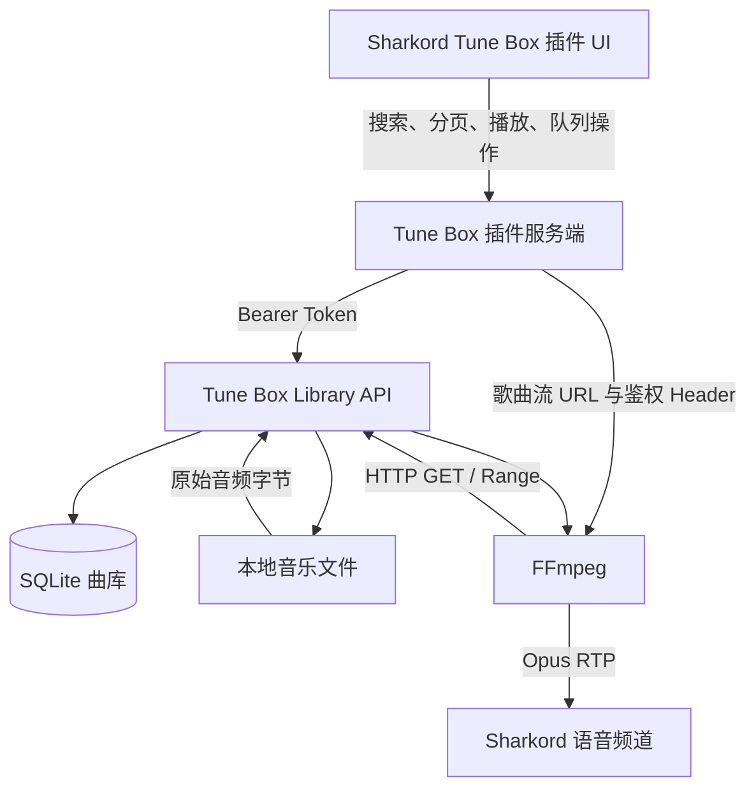

# Tune Box × Sharkord 本地曲库插件实施方案

> 状态：规划中  
> 目标：为 Sharkord 提供一个专门浏览、搜索和播放 Tune Box 本地曲库的插件。  
> 原则：复用现有 Music Bot 的 FFmpeg、RTP、队列和语音频道能力；Tune Box 负责曲库、元数据和文件流；新插件负责 UI 与播放控制。

## 1. 背景与已验证结论

当前 Tune Box 的试听接口：

```text
GET /api/preview?provider=netease&track_id=...&revision=...
```

已经可以被 Sharkord Music Bot 作为普通 HTTP 音频资源播放。这证明以下链路是可行的：

```text
Tune Box HTTP 音频响应
  → Music Bot 内置 FFmpeg
  → Opus/RTP
  → Sharkord 语音频道
```

但现有 Music Bot 对普通 HTTP 地址只把 URL 当作歌曲标题，不会主动读取 Tune Box 的歌名、歌手和封面。`/api/preview` 依赖上游音乐平台，也不代表 Tune Box 已下载和管理的本地曲库，因此不适合作为长期集成接口。

推荐新增独立的 Tune Box 曲库 API，并开发专用 Sharkord 插件。

## 2. 目标与非目标

### 2.1 MVP 目标

第一版应支持：

- 配置 Tune Box 服务地址；
- 测试 Tune Box 连接；
- 搜索本地曲库；
- 分页加载搜索结果；
- 显示歌曲名、歌手、专辑、格式和封面；
- 点击歌曲立即播放；
- 播放中点击歌曲时加入队列；
- 显示当前歌曲的歌名、歌手和封面；
- 查看、跳转和删除队列项；
- 停止和切换下一首；
- 设置后续歌曲的播放音量；
- 每个语音频道维护独立播放状态；
- Tune Box 不可用、歌曲不存在、文件不存在时返回明确错误。

### 2.2 第一版暂不实现

以下功能会显著增加复杂度，暂不纳入 MVP：

- 暂停后继续；
- 拖动播放进度；
- 上一首；
- 单曲循环、列表循环、随机播放；
- 歌单、收藏和播放历史；
- 歌词同步；
- 多个 Tune Box 实例；
- Tune Box 服务端实时转码；
- 用户级私人曲库权限。

## 3. 为什么使用独立插件

建议保留原 Music Bot，同时新增 Tune Box Music 插件：

| 插件 | 职责 |
|---|---|
| Music Bot | YouTube、关键词搜索、外部 HTTP/HTTPS 音频直链 |
| Tune Box Music | 浏览、搜索和播放 Tune Box 本地曲库 |

独立插件的优势：

1. 用户不需要复制内部 URL、数据库路径或 Token；
2. 不需要保留 `yt-dlp`、YouTube Cookie、代理和提取逻辑；
3. 队列可以围绕 Tune Box 歌曲 ID 建模，而不是围绕 URL 建模；
4. 可以原生展示歌名、歌手、封面、专辑和格式；
5. Tune Box API Token 只保存在插件设置中；
6. 原 Music Bot 可以继续升级，避免长期维护大型分叉。

新插件不应从空目录重新实现音频底层。推荐以现有 Music Bot 为模板：

- 保留 FFmpeg 下载与管理；
- 保留 FFmpeg → Opus/RTP；
- 保留 Sharkord Voice transport 和 producer；
- 保留按语音频道隔离的播放状态；
- 保留队列、停止、切歌和音量逻辑；
- 删除 `yt-dlp` 和全部 YouTube 专属逻辑；
- 重写数据源、队列模型和客户端 UI。

## 4. 推荐架构



职责边界：

### Tune Box

- 扫描和管理本地音乐文件；
- 保存歌曲元数据；
- 提供曲库搜索和分页；
- 根据歌曲 ID 提供元数据；
- 安全地提供原始音频文件流；
- 提供封面；
- 验证只读 API Token；
- 支持 HTTP Range。

### Sharkord 插件

- 提供曲库搜索和播放 UI；
- 调用 Tune Box API；
- 管理每个语音频道的队列和播放状态；
- 启动 FFmpeg 并转码为 Opus/RTP；
- 将歌名、歌手、封面和时长映射到 Sharkord Stream；
- 执行 Sharkord 权限检查；
- 处理 Tune Box 连接失败和歌曲失效。

## 5. Tune Box API 设计

API 建议统一放在版本化路径下：

```text
/api/v1/library/...
```

避免插件依赖 Dioxus Server Function 的内部协议。

### 5.1 健康检查

```http
GET /api/v1/health
Authorization: Bearer <music-bot-token>
```

响应：

```json
{
  "status": "ok",
  "version": "0.6.1"
}
```

用途：

- 插件设置页的“测试连接”；
- 区分网络错误、鉴权错误和版本不兼容；
- 后续进行 API 兼容性判断。

### 5.2 搜索和分页

```http
GET /api/v1/library/tracks?q=周杰伦&before_id=500&limit=20
Authorization: Bearer <music-bot-token>
```

建议响应：

```json
{
  "tracks": [
    {
      "id": 123,
      "title": "晴天",
      "artists": ["周杰伦"],
      "display_title": "晴天 — 周杰伦",
      "album": "叶惠美",
      "cover_url": "/api/v1/library/tracks/123/cover",
      "duration_seconds": 269,
      "extension": "flac",
      "size": 48392012,
      "revision": 1
    }
  ],
  "next_before_id": 123
}
```

说明：

- 复用现有 `Service::list_songs()` 的关键词和游标分页能力；
- `limit` 在服务端限制到合理范围，例如 `1..=100`；
- `display_title` 方便简单客户端直接展示，但仍保留结构化的 `title` 和 `artists`；
- `revision` 可用于缓存失效，第一版也可以固定为 `1` 或暂不返回。

### 5.3 查询单曲

```http
GET /api/v1/library/tracks/{id}
Authorization: Bearer <music-bot-token>
```

建议响应：

```json
{
  "id": 123,
  "title": "晴天",
  "artists": ["周杰伦"],
  "display_title": "晴天 — 周杰伦",
  "album": "叶惠美",
  "cover_url": "/api/v1/library/tracks/123/cover",
  "duration_seconds": 269,
  "extension": "flac",
  "size": 48392012,
  "stream_url": "/api/v1/library/tracks/123/stream",
  "revision": 1
}
```

队列应保存歌曲 ID 和元数据。真正开始播放时，插件应重新查询单曲或至少重新构造稳定的流 URL，以确认歌曲仍然存在。

### 5.4 音频文件流

```http
GET /api/v1/library/tracks/{id}/stream
HEAD /api/v1/library/tracks/{id}/stream
Authorization: Bearer <music-bot-token>
Range: bytes=0-1048575
```

必须正确支持：

- `GET`；
- `HEAD`；
- `200 OK`；
- `206 Partial Content`；
- `416 Range Not Satisfiable`；
- `Content-Type`；
- `Content-Length`；
- `Content-Range`；
- `Accept-Ranges: bytes`；
- 客户端断开时停止继续读取文件。

推荐启用 `tower-http` 的 `fs` feature，使用 `tower_http::services::ServeFile`，避免手写完整 Range 协议。

### 5.5 封面

```http
GET /api/v1/library/tracks/{id}/cover
Authorization: Bearer <music-bot-token>
```

第一阶段可以直接使用现有 `Metadata.cover_url`。后续再提供本地封面端点，以支持：

- FLAC 嵌入式封面；
- 不依赖第三方封面 URL；
- 统一缓存策略；
- `ETag` 和 `Cache-Control`。

如果歌曲没有封面，应返回 `404` 或在元数据中令 `cover_url` 为 `null`，不要返回无效字符串。

## 6. 元数据规则

Tune Box 当前已有 `Song` 和 `Metadata`，API 应统一使用以下回退规则：

1. 标题优先使用下载元数据中的非空 `metadata.name`；
2. 否则使用 `songs.name`；
3. 歌手优先使用非空 `metadata.artists`；
4. 否则使用扫描得到的 `song_artists`；
5. 歌手仍为空时可返回空数组，显示层使用“未知歌手”；
6. 专辑、封面等字段缺失时返回 `null` 或空值，但 API 内应保持一致。

建议显示名称：

```text
有歌手：歌曲名 — 歌手 A / 歌手 B
无歌手：歌曲名
```

不要只返回拼接字符串；结构化字段便于未来做歌手筛选和不同 UI 展示。

## 7. 文件访问安全

流接口只能接收数据库歌曲 ID，禁止接收客户端提供的磁盘路径。

错误示例：

```text
GET /api/stream?path=../../config/config.toml
```

正确示例：

```text
GET /api/v1/library/tracks/123/stream
```

每次打开文件前应：

1. 根据 ID 查询数据库路径；
2. `canonicalize()` 下载/曲库根目录；
3. `canonicalize()` 歌曲文件；
4. 验证歌曲规范路径以曲库根目录开头；
5. 验证目标是普通文件；
6. 文件或记录不存在时返回 `404`；
7. 路径越界时记录安全日志并返回通用错误，不返回服务器真实路径。

可复用当前 `delete_song()` 中已有的规范路径检查原则。

## 8. 鉴权设计

建议在 Tune Box 配置中新增独立的只读 Token：

```toml
[server]
music_bot_token = "replace-with-a-long-random-token"
```

不要复用 MCP Token。该 Token 只允许：

- 健康检查；
- 查询曲库；
- 查询歌曲元数据；
- 获取封面；
- 读取音频流。

不允许：

- 删除歌曲；
- 创建下载；
- 修改下载任务；
- 修改 Tune Box 配置。

插件的普通 API 请求使用：

```http
Authorization: Bearer <token>
```

FFmpeg 输入需要加入 HTTP Header，例如：

```text
-headers "Authorization: Bearer <token>\r\n"
```

注意事项：

- 插件日志不得打印 Token；
- 打印 FFmpeg 命令时必须对 Header 参数脱敏；
- UI 不得把 Token 返回给普通用户；
- Tune Box 鉴权比较应使用恒定时间比较；
- 鉴权失败返回 `401`，权限不足返回 `403`；
- Docker 内网也建议保留 Token，降低误配置后的风险。

如果 MVP 暂时不做鉴权，应确保 Tune Box 音频接口只暴露在可信 Docker 网络或局域网，不应直接暴露到公网。

## 9. Sharkord 插件设计

### 9.1 设置

建议提供：

- `Tune Box Base URL`，例如 `http://tune-box:8080`；
- `Tune Box API Token`；
- `Bitrate`，默认 `128k`；
- 可选请求超时；
- “测试连接”操作。

Base URL 应由管理员配置。普通用户只提交搜索词和歌曲 ID，不能指定任意元数据服务器地址。

### 9.2 Tune Box 客户端

新增独立模块，例如：

```text
src/server/tune-box.ts
```

职责：

- 规范化 Base URL；
- 添加鉴权 Header；
- 设置请求超时；
- 查询健康状态；
- 搜索曲库；
- 查询单曲；
- 解析相对 `stream_url` 和 `cover_url`；
- 将网络、HTTP 和 JSON 错误转换为可读错误；
- 限制响应体大小，避免异常服务器返回超大 JSON。

### 9.3 队列模型

不要继续只保存 URL。建议使用：

```ts
type TuneBoxTrack = {
  id: number;
  title: string;
  artists: string[];
  displayTitle: string;
  album?: string;
  coverUrl?: string;
  durationSeconds?: number;
  extension?: string;
  revision?: number;
};

type QueueItem = {
  track: TuneBoxTrack;
  invokerUserId: number;
};
```

队列中保存稳定的 Tune Box ID 和用于立即展示的元数据。不要把短期签名 URL 作为唯一数据保存。

### 9.4 播放流程

1. 用户点击歌曲；
2. 插件服务端验证用户在语音频道且拥有权限；
3. 空闲时立即播放，忙碌时加入当前频道队列；
4. 真正开始播放前确认歌曲仍然存在；
5. 构造 Tune Box 流 URL；
6. 启动 FFmpeg，通过 Header 发送 Token；
7. 将 `displayTitle` 作为 Sharkord Stream 标题；
8. 将 `coverUrl` 作为 banner；
9. 将 `durationSeconds` 写入播放器状态；
10. FFmpeg 正常结束后自动播放下一首。

### 9.5 FFmpeg

保留 Music Bot 现有输出参数和 RTP 管道。Tune Box 返回原始 FLAC/MP3/M4A 等文件，Tune Box 服务端不转码，由插件侧 FFmpeg 统一输出：

```text
Opus / 48 kHz / 双声道 / RTP
```

相比原 Music Bot：

- 只下载并检查 `ffmpeg`；
- 不再下载或检查 `yt-dlp`；
- 不再创建 `yt-dlp → ffmpeg` 管道；
- 为 HTTP 输入添加 Tune Box 鉴权 Header；
- FFmpeg 日志和命令日志必须隐藏 Token。

### 9.6 UI

MVP UI 建议包括：

- 搜索框；
- 加载状态；
- 连接失败提示；
- 搜索结果列表；
- 封面、标题、歌手、专辑和格式；
- “播放/排队”操作；
- 当前播放卡片；
- 队列列表；
- 跳转播放和删除队列项；
- 停止、下一首和音量。

UI 不应展示内部流 URL、Token 或服务器文件路径。

## 10. Tune Box 曲库页面辅助入口

可在 Tune Box 的 `SongItem` 中增加“复制到 Sharkord”按钮，复制：

```text
tunebox:123
```

这个格式优于复制完整 URL：

- 不暴露 Token；
- 不绑定 Tune Box IP 和端口；
- 服务地址改变后歌曲 ID 仍可用；
- 文本简短；
- 插件可通过管理员配置的 Base URL 查询元数据。

插件可以把 `tunebox:<id>` 作为快捷播放入口，但主要交互仍应是插件内的曲库搜索 UI。

## 11. 时长与封面演进

### 11.1 时长

当前曲库模型没有独立的 `duration_seconds`。第一版允许返回 `null`，不应阻塞播放功能。

后续建议扫描曲库时使用 `lofty` 读取音频属性，并在 `songs` 表增加：

```sql
duration_seconds INTEGER
```

必要时还可保存：

- `bitrate`；
- `sample_rate`；
- `channels`。

Music Bot 最优先需要的是 `duration_seconds`，用于进度条和预计结束时间。

### 11.2 封面

第一版使用已有 `metadata.cover_url`。后续解析并缓存本地嵌入式封面，通过 Tune Box 封面端点提供，避免依赖第三方链接。

## 12. Docker 和网络

如果 Tune Box 与 Sharkord 部署在同一台机器，推荐加入同一个 Docker 网络，并使用服务名：

```text
http://tune-box:8080
```

不要让容器内插件使用：

```text
http://127.0.0.1:8080
```

因为容器内的 `127.0.0.1` 指向 Sharkord 容器自身。

共享网络示例：

```yaml
networks:
  media:
    external: true
```

Tune Box 和 Sharkord 都加入 `media` 网络。这样可以：

- 避免依赖宿主机局域网 IP；
- 不需要对公网暴露音频端点；
- 减少网络绕行；
- 保持服务地址稳定。

如果两者不在同一容器网络，插件配置的 Tune Box URL 必须能从 Sharkord 服务端环境访问，而不仅仅是浏览器可访问。

## 13. 错误处理

Tune Box API 建议使用清晰状态码：

| 状态码 | 含义 |
|---|---|
| `200` | 查询或完整文件成功 |
| `206` | Range 文件响应成功 |
| `400` | 查询参数无效 |
| `401` | Token 缺失或无效 |
| `404` | 歌曲记录、文件或封面不存在 |
| `416` | Range 无效 |
| `429` | 请求过多 |
| `500` | Tune Box 内部错误 |
| `503` | 服务暂不可用 |

插件应把错误转换为用户可理解的信息，例如：

- “无法连接 Tune Box，请联系管理员检查插件配置”；
- “Tune Box 鉴权失败”；
- “歌曲已从曲库删除”；
- “歌曲文件不存在，请在 Tune Box 中重新扫描曲库”；
- “音频流中断，正在尝试播放下一首”。

日志应保留请求 ID、歌曲 ID和频道 ID，但不得记录 Token。

## 14. 并发与一致性

需要考虑：

- 多个语音频道可同时读取同一首歌；
- 播放过程中歌曲被删除；
- 搜索后歌曲在真正播放前被删除；
- Tune Box 重启或暂时不可用；
- 用户连续快速点击播放；
- 上一首结束回调与手动切歌同时发生。

建议：

- 每个语音频道独立状态；
- 使用现有 `streamStarting` 防止重复启动；
- 播放前重新确认歌曲；
- Tune Box 打开文件后再开始返回 Body；
- Linux 下已打开的文件即使随后被删除，当前读取通常仍可完成；
- 对手动停止、切歌和自然结束使用明确的结束原因，避免重复启动下一首；
- API 请求设置短连接/响应头超时，但不要用普通请求超时截断长音频响应体。

## 15. 测试计划

### 15.1 Tune Box 单元测试

- 元数据回退规则；
- 多歌手显示名称；
- 歌曲不存在；
- 数据库存在但文件不存在；
- 规范路径位于曲库根目录；
- 路径越界被拒绝；
- Token 正确、缺失和错误；
- Range 起始、结束、后缀和非法范围；
- `HEAD` 不返回响应体；
- 中文文件名与特殊字符。

### 15.2 Tune Box 接口测试

```bash
curl -I \
  -H 'Authorization: Bearer <token>' \
  http://localhost:8080/api/v1/library/tracks/123/stream
```

```bash
curl -v \
  -H 'Authorization: Bearer <token>' \
  -H 'Range: bytes=0-1023' \
  http://localhost:8080/api/v1/library/tracks/123/stream \
  -o /dev/null
```

验证 `206`、`Content-Range`、`Content-Length` 和 `Accept-Ranges`。

### 15.3 插件测试

- Tune Box 连接测试；
- 空搜索、中文搜索、歌手搜索；
- 搜索翻页；
- FLAC、MP3、M4A、AAC、OGG/Opus；
- 中文歌名和多歌手显示；
- 空闲立即播放；
- 播放中加入队列；
- 自动下一首；
- 手动切歌；
- 删除队列项；
- Tune Box 在排队后删除歌曲；
- 播放中 Tune Box 重启；
- 两个语音频道并发播放；
- Token 不出现在 UI 和日志；
- FFmpeg 异常退出后的状态清理。

## 16. 分阶段实施计划

### 里程碑 1：本地文件流验证

Tune Box：

- 增加单曲元数据接口；
- 增加本地文件流接口；
- 支持 Range 和路径安全检查；
- 暂不要求完整搜索 UI。

插件：

- 支持输入 `tunebox:<id>`；
- 获取元数据；
- 播放流；
- 显示“歌名 — 歌手”。

验收：

```text
tunebox:123
→ 获取正确元数据
→ 播放 Tune Box 本地文件
→ Sharkord 显示正确歌名和歌手
```

### 里程碑 2：专用曲库 UI

- Tune Box 搜索 API；
- 插件搜索框；
- 搜索结果列表；
- 分页；
- 封面；
- 播放和排队操作；
- 当前播放和队列 UI。

### 里程碑 3：安全与稳定性

- 专用只读 Token；
- FFmpeg Header 鉴权；
- 日志脱敏；
- 测试连接；
- 超时和错误映射；
- 并发与异常退出测试；
- Docker 共享网络文档。

### 里程碑 4：体验增强

- 本地封面端点；
- 曲库时长字段；
- Tune Box 页面“复制到 Sharkord”；
- 缓存、`ETag` 和版本协商；
- 可选循环和随机模式。

## 17. 预计改动范围

Tune Box 可能涉及：

```text
packages/contracts/src/library.rs
packages/backend/src/db/library.rs
packages/backend/src/service/library.rs
packages/backend/src/config.rs
packages/app/src/server.rs
packages/app/src/components/library.rs
config.example.toml
Cargo.toml
```

新 Sharkord 插件可复用 Music Bot 的：

```text
src/server/ffmpeg.ts
src/server/downloads.ts
src/server/paths.ts
src/server/player-state.ts
```

建议新增或重写：

```text
src/server/tune-box.ts
src/server/index.ts
src/client/*
src/contract.ts
manifest.json
README.md
```

实际实施时应先确认 Sharkord Plugin SDK 版本和 Music Bot 许可证，再决定复制代码、依赖原插件还是抽取共享模块。

## 18. 工作量与风险

MVP 粗略估算：

| 工作项 | 复杂度 | 估算 |
|---|---:|---:|
| Tune Box 元数据和搜索 API | 低 | 0.5 天 |
| 本地文件流、Range 和安全检查 | 低～中 | 0.5～1 天 |
| 插件 Tune Box 客户端和设置 | 低～中 | 0.5 天 |
| 播放状态和队列模型改造 | 中 | 0.5～1 天 |
| 曲库搜索 UI | 中 | 0.5～1 天 |
| 测试、错误处理和 Docker 联调 | 中 | 0.5～1 天 |

总体估算：约 **2～4 个开发日**，取决于 Sharkord Plugin SDK 熟悉程度和 UI 调试成本。

风险评估：

| 风险 | 等级 | 说明 |
|---|---:|---|
| 音频链路 | 低 | `/api/preview` 已实测可播放 |
| Tune Box API | 低 | 数据库、搜索和元数据模型已存在 |
| 文件 Range | 低～中 | 使用 `ServeFile` 可降低风险 |
| 插件 UI | 中 | 取决于 SDK 能力和现有 Music Bot UI 可复用程度 |
| 鉴权 Header | 中 | FFmpeg 参数和日志必须正确处理 Token |
| Docker 网络 | 低～中 | 需要确保 Sharkord 服务端能访问 Tune Box |
| 暂停和进度跳转 | 高 | 不纳入 MVP |

## 19. MVP 完成标准

满足以下条件即可认为第一版完成：

- [ ] Tune Box 提供稳定的版本化曲库 API；
- [ ] API 不暴露真实文件路径；
- [ ] 流接口支持 `GET`、`HEAD` 和 Range；
- [ ] 插件可以搜索和分页浏览本地曲库；
- [ ] 插件可以播放 FLAC、MP3 和 M4A；
- [ ] 当前播放和队列显示正确的歌名与歌手；
- [ ] 有封面时可以展示封面；
- [ ] 每个语音频道有独立队列；
- [ ] 停止、下一首、移除和跳转队列项可用；
- [ ] Tune Box 连接错误有明确提示；
- [ ] Token 不出现在普通用户 UI 和日志中；
- [ ] Tune Box 和 Sharkord 的 Docker 网络配置有文档；
- [ ] 关键路径有自动化测试或可重复的接口测试步骤。

## 20. 最终决策建议

采用“独立 Tune Box Music 插件 + Tune Box 版本化只读曲库 API”的方案。

短期先完成：

```text
歌曲 ID → 元数据 → 本地文件流 → Sharkord 显示歌名和歌手
```

验证后再实现完整曲库 UI。不要在第一版加入暂停、进度跳转、歌单和历史记录。这样可以最大化复用现有 Music Bot 的成熟播放链路，把主要开发工作限制在 API、数据模型和 UI 上，并保持 Tune Box 与 Sharkord 插件之间清晰、可维护的边界。
